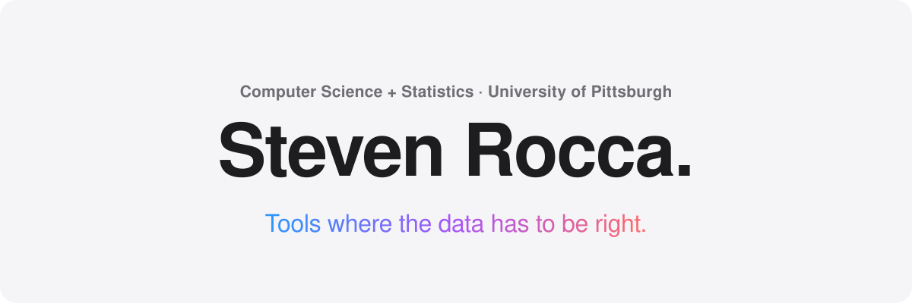
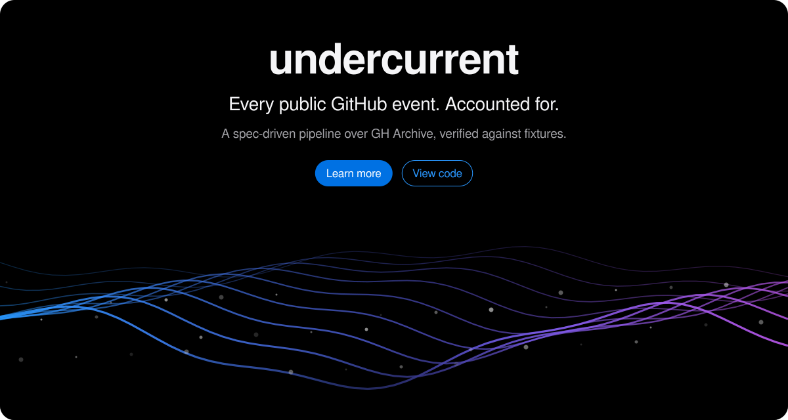
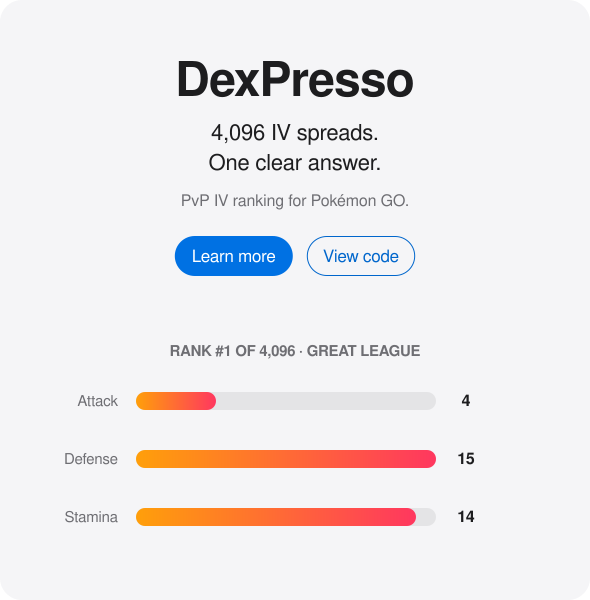
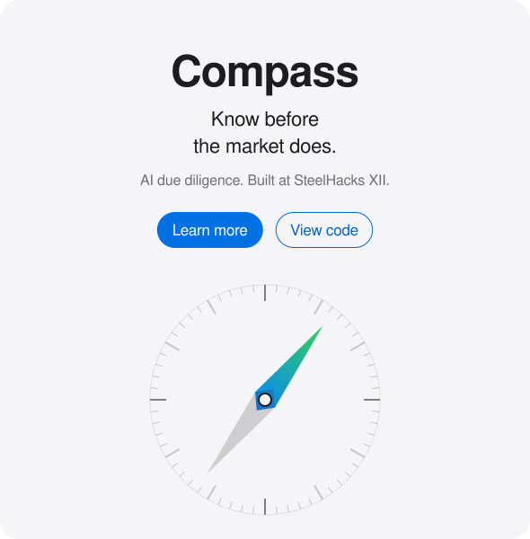
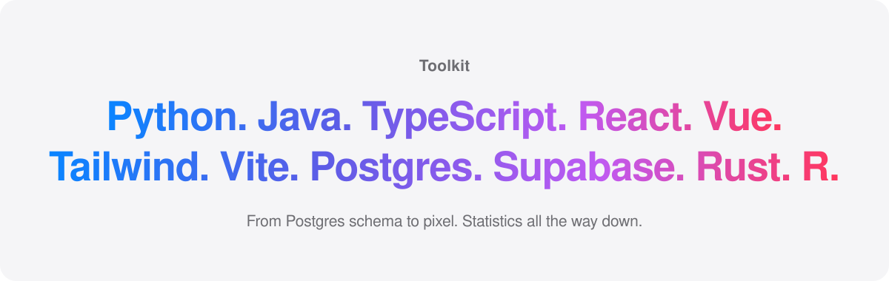

<picture>
  <source media="(prefers-color-scheme: dark)" srcset="./profile/tiles/hero-dark.svg" />
  
</picture>

  <a href="https://www.linkedin.com/in/steven-rocca3/"><picture><source media="(prefers-color-scheme: dark)" srcset="./profile/tiles/pill-linkedin-dark.svg" /></picture></a>
  &nbsp;
  <a href="mailto:srocca2000@outlook.com"><picture><source media="(prefers-color-scheme: dark)" srcset="./profile/tiles/pill-email-dark.svg" /></picture></a>

  

<a href="https://github.com/stevenrocca3/undercurrent">
  <picture>
    <source media="(prefers-color-scheme: dark)" srcset="./profile/tiles/undercurrent-dark.svg" />
    
  </picture>
</a>

  <a href="https://github.com/stevenrocca3/pokemon-team-optimizer"><picture><source media="(prefers-color-scheme: dark)" srcset="./profile/tiles/dexpresso-dark.svg" /></picture></a>
  <a href="https://github.com/ald3nreagins/compass"><picture><source media="(prefers-color-scheme: dark)" srcset="./profile/tiles/compass-dark.svg" /></picture></a>

<picture>
  <source media="(prefers-color-scheme: dark)" srcset="./profile/tiles/toolkit-dark.svg" />
  
</picture>

  <picture>
    <source media="(prefers-color-scheme: dark)" srcset="./profile/stats-dark.svg" />
    
  </picture>
  <picture>
    <source media="(prefers-color-scheme: dark)" srcset="./profile/top-langs-dark.svg" />
    
  </picture>

Stats refresh daily. Tiles generated by <a href="./profile/build.py"><code>profile/build.py</code></a>.

